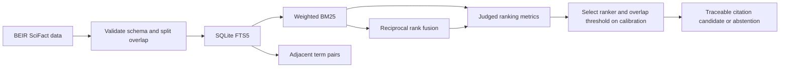

# Scientific Evidence Retrieval Audit

A CPU-reproducible benchmark for finding scientific abstracts and showing passages attributable to a local evidence index. It compares keyword retrieval with exact-phrase rank fusion and measures how often a query yields a candidate citation after abstention.

## Results

On 300 official SciFact test queries, BM25 outperformed the exact-bigram fusion at each reported rank metric.

| Test ranking | nDCG@10 | Recall@10 | MRR@10 |
| --- | ---: | ---: | ---: |
| Weighted BM25 | 0.677 | 0.798 | 0.644 |
| Unigram and bigram rank fusion | 0.589 | 0.759 | 0.540 |

The 0.40 overlap threshold, selected on 807 calibration queries, emitted 163 citation candidates on test. Of the cited top documents, 119 had a positive relevance judgment (73.0% of emissions, 54.3% coverage). Unsupported or refuting evidence can still be relevant. The benchmark measures document relevance. [Measured metrics](reports/scifact-metrics.json)

## Data and architecture



The fixed archive contains 5,183 abstracts. It is indexed with FTS5 unicode61 and a title boost of 2.5. Both rankers use the same word tokenizer and content words. The second adds an adjacent-phrase list and reciprocal rank fusion over top-50 lists with rank constant 60. Query input becomes quoted terms and a bound FTS parameter. The answer mode selects a sentence by normalized query-token overlap and returns the source ID and a short extract. It emits an abstention below the calibrated threshold.

## Installation and reproduction

Use Python 3.11+ and SQLite compiled with FTS5. The code uses the standard library.

```sh
python scifact_audit.py fetch --archive data/raw/scifact.zip
python scifact_audit.py build --archive data/raw/scifact.zip --index runs/scifact.sqlite
python scifact_audit.py evaluate --index runs/scifact.sqlite --out runs/benchmark
python scifact_audit.py search --index runs/scifact.sqlite "Climate change impacts plant growth"
python scifact_audit.py answer --index runs/scifact.sqlite --calibration runs/benchmark/metrics.json "Climate change impacts plant growth"
python -m unittest discover -s tests -v
```

The run writes per-query outcomes and aggregated metrics. Corpus and calibration hashes must match when extracting a citation. [Source schema and rights](data/README.md)

## Evaluation and limitations

Use mean nDCG, Recall and MRR at 1, 5 and 10. Model selection uses nDCG@10. Gate selection maximizes F0.5 on calibration, treating queries with no cited, judged relevant top document as misses. The test split stays at 300 official queries. ID overlap is rejected, and two normalized text overlaps are filtered from calibration. Unjudged documents receive zero gain under the metrics and may contain relevant information. The extracted sentence is an evidence candidate. Establishing support, refutation or scientific validity requires reviewing that passage and context. Publication rights for titles and abstracts follow the upstream corpus terms.

A compact dense baseline and independent sentence-level review are follow-up experiments. Manual reading and source verification can use [the documented NotebookLM workflow](docs/notebooklm.md).

## License and references

MIT for this code. [SciFact paper](https://aclanthology.org/2020.emnlp-main.609/) · [BEIR paper](https://arxiv.org/abs/2104.08663) · [Upstream data licenses](https://github.com/allenai/scifact/blob/master/LICENSE.md)
